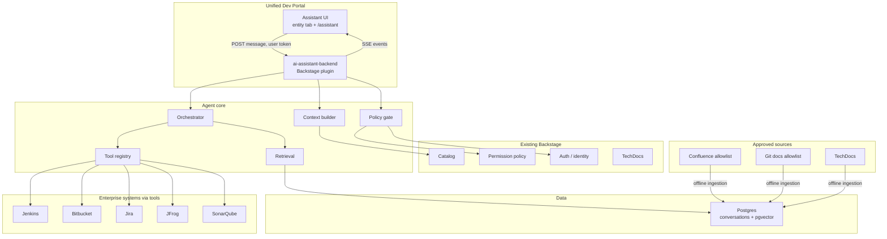
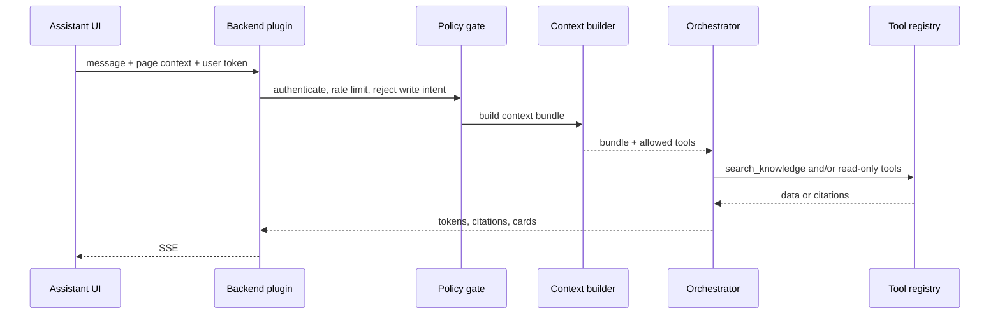
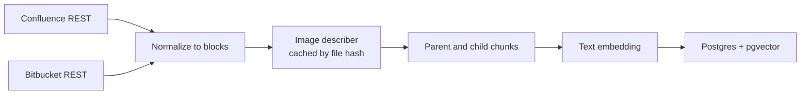
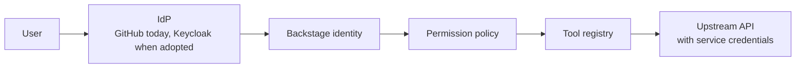

# AI Platform Assistant — Architecture

Status: **Proposed for review** · v0.2 · 26 Sep 2026

This document replaces the v0.1 system design. It is the design we implement against once the decisions in [§15](#15-decisions-to-confirm) are agreed. No application code is in scope until then.

The assistant is a Backstage-native conversational layer. It answers platform questions from real documentation, explains the application the user is looking at, and — only after that path is reliable — calls read-only APIs on Jenkins, Bitbucket, Jira, JFrog, and SonarQube. Write actions stay out until authorization and confirmation exist.

---


## 1. What changed from v0.1

v0.1 assumed an `@openai/agents` Triage → specialist-agent runtime already existed, and treated MCP as a late add-on. This repository does not contain that runtime. Auth today is GitHub plus guest, and the permission policy is allow-all. Jenkins is configured for the scaffolder only. Jira, JFrog, SonarQube, and Confluence are named on EAR application records; they are not integrated yet.

The design below keeps the product intent of v0.1 and changes the shape:


| v0.1                                           | v0.2 recommendation                                                        | Why                                                                                                                                                                                                                          |
| ---------------------------------------------- | -------------------------------------------------------------------------- | ---------------------------------------------------------------------------------------------------------------------------------------------------------------------------------------------------------------------------- |
| Triage agent routes to a specialist per system | One orchestrator. Systems are tools, not agents                            | A router model adds a hop, misroutes, and has to be edited whenever a tool appears. The model already chooses tools. Specialists come back only when a task needs a different prompt, tool subset, and confirmation protocol |
| `@openai/agents` as the core                   | A small Agent Runtime interface. The SDK sits behind it                    | The chat, retrieval, and authz should not import a vendor SDK. OpenAI Agents SDK remains a valid first implementation if that is the approved provider                                                                       |
| RAG always run by Triage                       | Agentic retrieval: `search_knowledge` is a tool                            | Knowledge questions retrieve. Build questions call Jenkins. Mixed questions do both. The orchestrator decides per turn                                                                                                       |
| MCP in phases 10–13                            | Tools are MCP-shaped from day one. MCP transport waits for a second client | The contract (name, JSON Schema, read-only, destructive) is the MCP tool shape. A separate MCP server is justified when Slack, an IDE, or a CLI needs the same tools                                                         |
| Standalone Node “SSE gateway”                  | Backstage backend plugin, plus a frontend plugin                           | Identity, catalog, config, logging, and permissions already live in this backend. A second process would reimplement them                                                                                                    |
| Keycloak checked inside the tool registry      | Backstage identity and permission policy in front of tools                 | The IdP can change (GitHub today, Keycloak later). Tools must not grow a second authorization system                                                                                                                         |
| Model picks Jenkins job names                  | Tools are bound to the resolved application                                | Stops the model querying an arbitrary job, repo, or project the user typed or that appeared in a log                                                                                                                         |


---


## 2. Goals and non-goals


### Goals

- Answer platform questions from approved documentation, with a citation on every factual claim.
- Use the application the user is viewing (catalog entity and, when present, the EAR record) so the user does not restate owner, repo, Jenkins job, or Sonar project.
- Call a small set of read-only tools when the answer depends on live state.
- Stream the answer as it is produced, including short status while a tool runs.
- Record which questions the docs could not answer, so those become a documentation backlog.
- Keep the agent core callable later from something that is not this React app.


### Non-goals for the first releases

- Triggering builds, deployments, branch changes, or ticket creation.
- Autonomous multi-step remediation (“fix the pipeline and rerun it”).
- A general coding assistant or a replacement for Backstage Search and TechDocs.
- Training or fine-tuning a model on internal data.
- Letting the browser hold integration credentials or call Jenkins, Bitbucket, Jira, JFrog, or SonarQube directly.

---


## 3. Product shape

Two surfaces, one backend:

1. **Entity assistant** on the catalog entity page. The context bundle is that entity. This is the primary surface for “why did my build fail?” and “how do I deploy this app to SIT?”.
2. **Global assistant** at `/assistant`, linked from the sidebar. Used for platform questions that are not about one component (“what is the difference between SIT and UAT?”). If the user names an application, the orchestrator may call `resolve_application`, which only returns entities the user is allowed to see.

The UI renders three kinds of content, not a single blob of markdown:

- Streamed prose.
- **Citations** (title, source system, URL or doc path).
- **Cards** for tool results (build status, pull requests, quality gate, artifact versions). Cards are structured events. The model may summarize them; the UI does not scrape the summary to rebuild the card.

A message can be retried. Retry reuses the same context snapshot and does not silently call write tools (there are none yet).

### First milestone

Five questions, answered from documentation only, each citing the source passage:

1. How do I create an application?
2. How do I deploy to SIT?
3. What is the difference between SIT and UAT?
4. How do I triage a Jenkins failure? (procedure from the runbook; live logs come in the tool milestone)
5. What is the production deployment process?

Exit criteria are in [§14](#14-roadmap). Live tools are not required for this milestone.

---


## 4. System context




The assistant does not sit on the browser’s proxy to those systems. The backend holds integration credentials. The browser only talks to the assistant plugin, with the Backstage user token.

---


## 5. Components


| Component                     | Responsibility                                                                                                                                                                                                                                                           |
| ----------------------------- | ------------------------------------------------------------------------------------------------------------------------------------------------------------------------------------------------------------------------------------------------------------------------ |
| `plugin-ai-assistant`         | React plugin. Conversation transcript, composer, streaming client, citation list, tool cards. Reads the current entity from the catalog page when mounted there. Sends the user credential on every request.                                                             |
| `plugin-ai-assistant-backend` | HTTP API, SSE, session persistence, authn, permission checks, wiring of catalog and integrations. This is the only network boundary.                                                                                                                                     |
| Agent core                    | Library inside the backend plugin (`plugins/ai-assistant-backend/src/core` until a second caller exists). Orchestrator loop, tool registry, retrieval, context builder, redaction. No Backstage HTTP types inside the loop, so a later MCP or Slack adapter can call it. |
| Context builder               | Turns “the page the user is on” plus catalog and EAR data into a **context bundle**. The model sees the bundle. Tools receive the bundle’s resolved identifiers, not free-form names from the model.                                                                     |
| Orchestrator                  | One model loop with the tools it is allowed to use on this turn. Streams tokens and emits tool and citation events.                                                                                                                                                      |
| Tool registry                 | Declares schema and policy metadata. Filters the tool list per user and per application. Executes the tool. Writes an audit row.                                                                                                                                         |
| Retrieval                     | `search_knowledge` implementation: query rewrite using the bundle, metadata filter, hybrid search, rerank, citation payload.                                                                                                                                             |
| Ingestion jobs                | Scheduled tasks. Parse → chunk → embed → upsert. Never on the chat request path.                                                                                                                                                                                         |
| Permission policy             | New rules in the Backstage permission backend. Replaces allow-all for assistant actions when enforcement starts. Until then, read-only tools still check catalog visibility.                                                                                             |


### Package layout

Follow the empty `plugins/` convention in this repo:

```
plugins/ai-assistant/                  frontend plugin
plugins/ai-assistant-backend/          backend plugin + agent core
plugins/ai-assistant-common/           event types, permission definitions, tool ids
```

Register the backend plugin from `packages/backend/src/index.ts`. Register the route and the entity tab from `packages/app`.

### Backend runtime

Use **Node.js and TypeScript**, as the Backstage backend plugin above. Do not build a separate Spring AI microservice for the assistant.

Spring AI is a capable agent stack (tool calling, advisors, vector stores, MCP). The mismatch is placement. This portal’s identity, catalog, permissions, config, and Jenkins credentials already live in the Node backend. The chat has to resolve the signed-in user, build the context bundle, authorize the tool, and stream tokens. Doing that in Spring means a second deployable that re-checks the Backstage token, re-reads the catalog, and adds a network hop on the path that is supposed to emit a first token quickly.

Node is also where the orchestrator libraries this design can sit on already are: the OpenAI Agents SDK, the AI SDK, and the TypeScript MCP SDK. The model provider stays behind `AgentRuntime`, so the choice of Azure OpenAI, OpenAI, or an internal gateway is independent of the language.

Existing or future system APIs stay where they are. Bitbucket permission reads are already shaped as a Backstage proxy call to `/ddp/bitbucket/...`. If that DDP service is Spring, the assistant tool calls it server-side the same way. DDP remains the system API. It does not become the chat runtime.

Move the agent loop to Spring AI only if the organization already runs an approved Spring AI platform (model gateway, pgvector, audit) and will not operate Node beyond Backstage. In that case the Backstage plugin stays a thin edge: authenticate, build the context bundle, proxy the SSE stream. The browser still does not call Spring directly.

---


## 6. Agent design


### One orchestrator

A turn looks like this:




The system prompt has a stable section (role, citation rules, refusal rules) and a per-turn section (context bundle, tool list). Retrieved passages and tool payloads are passed as tool results, never concatenated into the system prompt as instructions.

### What “agentic” means here

The model may take several tool steps before it answers: search docs, then read a build, then read the failing log excerpt. That loop is capped.


| Limit                           | Starting value                         | Reason                                                                 |
| ------------------------------- | -------------------------------------- | ---------------------------------------------------------------------- |
| Tool rounds per user message    | 4                                      | Enough for search + one system + a follow-up read. Stops runaway loops |
| Wall clock per turn             | 30s                                    | User is watching a stream. Status events cover the wait                |
| Retrieved chunks in context     | 8                                      | Quality drops when the prompt is a pile of loosely related pages       |
| Log excerpt passed to the model | 200 lines around the failure, redacted | Full logs blow the context window and leak secrets                     |


If the cap is hit, the assistant says what it already knows and what it did not finish. It does not invent the rest.

### Skills, not specialist agents

System-specific reasoning (how a multibranch Jenkins job URL is formed, how a Sonar project key is derived) lives in the **tool implementation and its description**, plus a short skill snippet loaded only when that tool is in the allowed set. The orchestrator does not hand off to a Jenkins model.

Add a second agent only when all three are true:

- The task needs a different system prompt (the action agent, later).
- It needs a disjoint tool set (write tools hidden from the read-only orchestrator).
- It needs a different control flow (propose → user confirms → execute).

That is the Phase “Actions” design. It is not the first runtime.

### SDK boundary

```ts
interface AgentRuntime {
  run(input: RunInput, emit: (event: AssistantEvent) => void): Promise<RunResult>;
}
```

`RunInput` is the user message, context bundle, allowed tool definitions, and prior turns. The first implementation may use the OpenAI Agents SDK or the provider’s tool-calling API. Swapping the SDK must not change the SSE events or the tool contract.

Provider choice (Azure OpenAI, OpenAI, or an internal gateway) is an open decision. The runtime reads model, endpoint, and credential from Backstage config. Secrets stay in environment variables, same as `JENKINS_API_KEY` today.

---


## 7. Context bundle

The bundle is the unit of “which application are we talking about?”. It is built on the server from data the user is allowed to read. The client sends only a hint: entity ref, or empty when the chat is global.

Resolved fields, omitted when unknown:


| Field                                                                                                                 | Source                                                           |
| --------------------------------------------------------------------------------------------------------------------- | ---------------------------------------------------------------- |
| Entity ref, kind, type, title, owner, lifecycle, system                                                               | Catalog                                                          |
| Links and annotations the integrations need (`jenkins.io/job-full-name`, repo URL, Sonar project, artifact name)      | Catalog annotations, filled over time                            |
| EAR record: app code, domain, L2/L3, lead, and which Jenkins / Bitbucket / Sonar / Artifactory instance this app uses | Existing EAR data once it is a real API rather than fixture data |
| Branching metadata: project key, repo, strategy link                                                                  | Existing Bitbucket branching data, same caveat                   |


The snapshot is stored with the user message. Later turns in the conversation keep that snapshot unless the user changes entity. A catalog edit mid-conversation does not silently retarget tools.

`resolve_application` is the only tool that may change the bundle. It searches the catalog by name or app code, enforces catalog visibility, and returns candidates when the name is ambiguous. The assistant asks the user to pick. It does not guess.

---


## 8. Knowledge layer


### Sources in scope

Static knowledge comes from **Confluence** and **Bitbucket**. Ingestion is an allowlist of spaces and repositories, not a crawl of either system. TechDocs can be added later as a third connector; it is not required for the first five answers.


| Source     | What is ingested                                                                                          | What is excluded                                                              |
| ---------- | --------------------------------------------------------------------------------------------------------- | ----------------------------------------------------------------------------- |
| Confluence | Allowlisted spaces and their pages: headings, lists, tables, code macros, and images that carry meaning | Personal spaces, meeting notes, restricted pages, unrestricted site search    |
| Bitbucket  | Default branch of allowlisted repos: `README`, `docs/**`, runbooks, and markdown images under those paths | Source code, lockfiles, `.env`, binaries, feature branches, whole-repo clone into the index |


Page and file restrictions are enforced by **what is allowed into the index**, not by a filter the model can forget. v1 ingests only spaces and repos already visible to every signed-in developer. A page with extra Confluence restrictions is skipped and logged. Query-time ACL filtering is a later phase if restricted docs must be included.

### Pipeline

Ingestion is a scheduled job in the Backstage backend. A question never waits on Confluence or Bitbucket. Both connectors emit the same internal document, so chunking and embedding do not care which system a page came from.



Steps:

1. **Discover changes.** Confluence: pages in the allowlisted spaces whose version is newer than the stored cursor (`lastModified` / content version). Bitbucket: commits on the default branch since the stored SHA, limited to the path allowlist. Deletes and pages that fall out of the allowlist remove their chunks.
2. **Normalize.** Turn the page into ordered blocks: heading, paragraph, list, table, code, and image. Confluence storage format (`ac:image`, draw.io and Gliffy attachments) and Bitbucket markdown (``) both become an image block pointing at a file, not at pixels in the HTML.
3. **Describe images.** For each image whose bytes changed, a vision model writes a text description. Unchanged bytes are skipped via a SHA-256 cache. See below.
4. **Chunk.** Build a parent chunk per section and smaller child chunks for search. Embed the children. Return the parent to the model when a child matches.
5. **Upsert.** Insert or update by `(source, external_id, chunk_key)`. Re-embed only when `content_hash` changes. Chat embeds the user query only.

Service credentials for Confluence and Bitbucket stay in backend config, same as Jenkins. The job runs as the platform, not as the user who asked a question.

### Confluence and Bitbucket images

Many procedures live in screenshots and diagrams. Extracting page text and dropping images will miss those steps. Embedding the image pixels in pgvector is also the wrong v1: a text question and an image vector only meet if both were produced by the same multimodal model, and that index is harder to cite and to hybrid-search.

v1 stores **text produced from the image**, plus a link back to the source file.

For every non-decorative image:

- Download the attachment (Confluence) or the file at that commit (Bitbucket).
- Skip icons and emoji: small files, known emoticon paths, and images the vision model marks as decorative. They produce no chunk.
- Send the image once to a vision model. The prompt asks for two parts: visible text transcribed verbatim, then a description of structure (steps, labels, arrows, table cells). Draw.io and Gliffy previews are handled as the exported PNG already attached to the page.
- Cache the result by SHA-256 of the bytes. A page edit that does not change the image does not call the vision model again.
- Write a child chunk whose text is the section heading plus that description. Metadata records `chunk_type: image_description`, the attachment id, and the page URL.
- Do not store the image bytes in Postgres. The citation opens the Confluence page or Bitbucket file. A later UI can proxy a thumbnail; the index does not need the binary.

Caps, because Confluence pages can hold dozens of images: maximum images per page (start at 20, largest first), maximum bytes per image, and a concurrency limit on vision calls. Animated GIFs are skipped or reduced to the first frame. PDF attachments are out of scope until a page in the five milestone procedures actually depends on one.

The answering model does not see pixels at question time. If evaluation shows a description lost a step, add a rare tool that re-reads one cited attachment. That tool is not part of the first ingestion milestone.

### Chunks and tables

| Block | How it is stored |
| --- | --- |
| Section under a heading | One parent chunk: heading path (`Deploy / SIT`), body text, and image descriptions that sit in that section |
| Long section | Child chunks of roughly 400–800 tokens, split on paragraphs, each storing `parent_id` |
| Table | Markdown table. Kept whole when it fits in one child; otherwise split by rows with the header repeated |
| Code macro | One child, not mixed into the surrounding paragraph |
| Confluence `include` / `excerpt` | Not expanded. Stored as a link to the included page so one restricted page cannot be copied into an open page’s chunk |

Children are what hybrid search ranks. The text returned to the orchestrator is the parent, so the model sees the step above and below the matching paragraph. An image description stays attached to the section it illustrates, which is what makes “the deploy diagram” retrievable from a text question.

### What is stored in Postgres

```text
knowledge_document
  source                  confluence | bitbucket
  external_id             page id or repo path
  url
  title
  space_or_repo
  version                 confluence version or git sha
  updated_at
  content_hash

knowledge_chunk
  document_id
  parent_id               null for a parent chunk
  chunk_key               stable id within the document
  chunk_type              text | table | code | image_description
  heading_path
  body
  embedding               vector, null on parent chunks
  search_text             generated tsvector for full-text search
  content_hash

knowledge_image
  sha256                  primary key
  media_type
  description
  decorative              boolean
```

Metadata used as filters lives on the document and is copied onto each child for the query: `source`, `space_or_repo`, `application`, `team`, `technology`, `document_type`, `updated_at`. Application and team may be empty for platform-wide pages such as SIT vs UAT.

Use a 1536- or 1024-dimension column only after the embedding model is chosen, and create an HNSW index on `knowledge_chunk.embedding`. Full-text search uses `search_text` on the same rows. One database, two indexes.

### Retrieval

`search_knowledge` does, in order:

1. **Rewrite** the query with the bundle (application name, tech stack) so “deploy to SIT” for a Java service does not retrieve a mobile runbook. The rewrite is deterministic prefixing plus the user’s words. A model rewrite is optional and only enabled if the eval set shows it helps.
2. **Filter** by metadata the bundle makes safe to apply. Platform-wide docs stay eligible. Docs tagged to a different application are excluded.
3. **Hybrid search** over child chunks: pgvector similarity and full-text search.
4. **Expand** each hit to its parent section before it is given to the model.
5. **Rerank** the parents down to the chunk cap. Skip rerank until the eval set shows the hybrid list is the thing that is wrong.
6. Return passages with citation ids, including image citations (page URL plus attachment name). The orchestrator may only state doc facts that appear in those passages.

### Freshness

A scheduled job re-ingests changed pages and commits. Chat never waits on Confluence or Bitbucket. The citation shows the source `updated_at` so a stale page is visible.

### Relationship to Backstage Search

Backstage Search stays the documentation search page. It is not the RAG index. RAG needs chunk boundaries, image descriptions, embeddings, metadata filters, and stable citation ids.

---


## 9. Tools and MCP


### Contract

Every tool is registered with the same fields an MCP tool uses, whether or not it is served over MCP:

```ts
type ToolSpec = {
  name: string;
  description: string;
  inputSchema: JsonSchema;
  annotations: {
    readOnlyHint: boolean;
    destructiveHint: boolean;
    idempotentHint: boolean;
  };
  requiredPermission: string;
  bindsTo: 'context-bundle' | 'user-argument';
};
```

`readOnlyHint: false` or `destructiveHint: true` is rejected by the registry until the actions phase. The model cannot talk the registry into running it.

### Entity binding

For `bindsTo: 'context-bundle'`, the model does not supply the Jenkins job, Bitbucket repo, Jira project, or Sonar key. The registry fills those from the bundle. If the identifier is missing, the tool returns a structured gap (`jenkins_job_unresolved`) and the assistant says which catalog annotation or EAR field is missing. It does not search the whole Jenkins server.

`bindsTo: 'user-argument'` is rare in v1. `search_knowledge` and `resolve_application` are the main cases, and both still apply authorization filters.

### First read-only set

Ship in this order. Each tool needs a recorded fixture for tests before it is enabled in production.


| Order | System    | Tools                                                    | Depends on                                                                         |
| ----- | --------- | -------------------------------------------------------- | ---------------------------------------------------------------------------------- |
| 1     | Knowledge | `search_knowledge`                                       | pgvector + allowlisted docs                                                        |
| 2     | Catalog   | `resolve_application`                                    | Catalog API + visibility                                                           |
| 3     | Jenkins   | `get_latest_build`, `get_build_status`, `get_build_logs` | Job bound from the bundle. Logs redacted before the model and before the card      |
| 4     | Bitbucket | `get_repository`, `get_branches`, `get_pull_requests`    | Repo bound from the bundle                                                         |
| 5     | SonarQube | `get_quality_gate_status`                                | Project key bound from the bundle                                                  |
| 6     | JFrog     | `get_artifact`, `get_artifact_versions`                  | Artifact name bound from the bundle                                                |
| 7     | Jira      | `get_issue`, `search_issues`                             | Search scoped to the application’s project or label, not global JQL from the model |


Jira search does not accept arbitrary JQL from the model. The tool takes a small parameter object (text, status, assignee = current user). The server builds the query.

### MCP, precisely


| Layer                       | Now                                          | Later                                                                                                               |
| --------------------------- | -------------------------------------------- | ------------------------------------------------------------------------------------------------------------------- |
| Tool schema and annotations | Yes. Internal registry                       | Same objects published as MCP tools                                                                                 |
| In-process execution        | Yes. One network hop to Jenkins or Bitbucket | Remains for the Backstage plugin                                                                                    |
| MCP server process          | No                                           | When a second client (Slack, Teams, IDE, CLI) must call the same tools with the same authz                          |
| Backstage catalog over MCP  | No                                           | Optional. The context builder already calls the catalog in-process. An MCP catalog server does not improve the chat |


The assistant UI does not speak MCP. MCP is a tool transport for non-UI clients. Putting MCP between React and the orchestrator adds a protocol without a second client to serve.

If a vendor already ships an official MCP server (some Git hosts and issue trackers do), prefer that server **behind** our registry so the permission check, entity binding, and audit log still happen in this backend. The model never holds the MCP session or the upstream token.

### Action tools, deferred

`trigger_sit_deployment` and similar tools are specified now so the contract does not get redesigned later, and they are not registered.

When they are added:

- A separate action agent, with only the write tools for the confirmed action.
- The UI shows a confirmation card: action name, target application, parameters, idempotency key.
- Nothing runs until the user confirms that card. A model sentence (“yes, do it”) is not confirmation.
- The audit log stores who confirmed, what ran, and the upstream response id.

---


## 10. Request and stream contract

`EventSource` is GET-only and cannot send the user token cleanly. The client uses `fetch` with the Backstage credential and reads `text/event-stream`.

`POST /api/ai-assistant/conversations/:id/messages`

```json
{
  "text": "Why did my build fail?",
  "page": { "entityRef": "component:default/payments-api" }
}
```

SSE events:


| Event      | Payload                                                         | UI behavior                                                          |
| ---------- | --------------------------------------------------------------- | -------------------------------------------------------------------- |
| `status`   | `{ "phase": "retrieving" | "calling_tool" | "answering" }`      | Non-token progress. Satisfies the latency requirement for tool turns |
| `tool`     | `{ "id", "name", "state": "started" | "completed" | "failed" }` | Tool row. Inputs are summarized. Secrets never included              |
| `citation` | `{ "id", "title", "url", "source" }`                            | Citation chip                                                        |
| `card`     | `{ "type", "payload" }`                                         | Structured card                                                      |
| `delta`    | `{ "text" }`                                                    | Append to the answer                                                 |
| `done`     | `{ "messageId" }`                                               | Close the stream                                                     |
| `error`    | `{ "code", "message" }`                                         | User-visible failure, no stack trace                                 |


Conversation create, list, and delete are ordinary JSON routes. History load does not re-run tools.

---


## 11. Security and authorization




Rules:

1. Every message requires a Backstage user token. Guest is disabled for this plugin even if guest remains available elsewhere.
2. Integration credentials live in backend config only. They are never sent to the model, the browser, or the audit payload.
3. Catalog visibility is necessary but not sufficient. Each tool names a permission (`aiAssistant.jenkins.read`, and so on). The permission policy may start by allowing signed-in users and tighten to ownership later without changing tools.
4. Retrieved text, build logs, and ticket bodies are **untrusted data**. They can contain prompt injection. The runtime wraps them as tool output and instructs the model to treat them as evidence, not as commands. Tools still cannot be added by that text because the registry, not the model, holds the executable set.
5. A redactor runs on tool output before the model and before `card` events. Patterns include tokens, passwords, `Authorization` headers, and private keys. Redaction is best-effort and is tested with fixtures.
6. The model cannot override `readOnlyHint` or expand a bound identifier.
7. Conversations are per user. Another user cannot read the transcript, including by guessing a conversation id.
8. Rate limit per user on message create and on tool calls.

The current allow-all permission module must not be the production policy for this plugin. Enforcement of assistant permissions is a roadmap exit criterion before any live production credentials are attached.

### Data the model is allowed to see

The context bundle, the allowed tool results, and the retrieved chunks for this turn. Not: other users’ chats, raw environment variables, or unrestricted search across Confluence.

---


## 12. Persistence

Postgres in deployed environments. Local development may use the existing database client; pgvector is required once retrieval starts, including in shared dev.


| Store                    | Contents                                                    | Retention                                                   |
| ------------------------ | ----------------------------------------------------------- | ----------------------------------------------------------- |
| `assistant_conversation` | id, user entity ref, created time                           | Until the user deletes it, or the platform retention period |
| `assistant_message`      | role, text, context snapshot, status                        | Same as the conversation                                    |
| `assistant_tool_call`    | tool name, bound target ids, outcome, latency. Not raw logs | 90 days, then aggregated                                    |
| `assistant_feedback`     | thumbs, optional comment, message id                        | Kept with the eval export                                   |
| `knowledge_chunk`        | text, embedding, metadata, content hash                     | Replaced on re-ingest                                       |


Full build logs are not stored in the assistant database. The card holds a permalink to Jenkins plus the redacted excerpt that was shown.

---


## 13. Observability and evaluation


### Operational signals

Correlate by `conversationId` and `messageId` in the existing backend logs:

- Time to first `status`, first `delta`, and `done`.
- Tool name, outcome, latency. No log bodies.
- Retrieval: chunk ids returned, whether the answer cited them.
- Token usage per turn.
- Outcome class: answered with citation, answered from tools, partial, unanswered, refused, errored.

Unanswered and “answered with no citation” on a knowledge question are the documentation backlog. Export them weekly. Do not silently retrain on them.

### Eval set

Phase 0’s 20–30 questions become a checked-in dataset, not a workshop artifact. Each item has:

- Question and fixture context bundle.
- Class: `knowledge`, `live`, `mixed`, or `action`.
- Expected tool names, if any.
- Expected citation URLs or doc ids, if knowledge.
- Must-not-include: other applications’ data, secrets, invented deploy steps.
- For `action` items in early phases: must refuse.

CI runs the set against fixture tools and a frozen knowledge index. Live Jenkins is not a CI dependency. A release that drops any of the five milestone questions below the agreed bar does not ship.

Human review stays on a sample of real transcripts. Thumbs alone are not the quality bar.

---


## 14. Roadmap

Each phase has an exit criterion. Later phases do not start by skipping it.


| Phase | Deliverable                                                                                                    | Exit criterion                                                                                                               |
| ----- | -------------------------------------------------------------------------------------------------------------- | ---------------------------------------------------------------------------------------------------------------------------- |
| 0     | Question set, source allowlist for the five milestone docs, provider decision                                  | Dataset checked in. Owners named for each source. Model endpoint approved                                                    |
| 1     | Frontend and backend plugins, SSE, conversations, entity tab and `/assistant`, context bundle from the catalog | A signed-in user can ask a question and see a streamed reply that quotes the bundle. Guest is rejected                       |
| 2     | Ingestion + `search_knowledge` + citations                                                                     | The five milestone questions cite the right passage on the eval set                                                          |
| 3     | Jenkins read-only tools, redaction, entity binding                                                             | “Why did my build fail?” uses the bound job and a redacted log excerpt. A question about another app does not query that job |
| 4     | Bitbucket, SonarQube, JFrog, Jira read-only tools                                                              | Each tool has a fixture test and a permission id. Missing bindings produce a gap, not a global search                        |
| 5     | Permission policy and audit log                                                                                | Allow-all is not what authorizes these tools. Audit row per tool call                                                        |
| 6     | Eval in CI, unanswered-question export                                                                         | Milestone regression fails the pipeline                                                                                      |
| 7     | Action agent + confirmation cards                                                                              | No write tool is callable without a confirmation id issued by the API                                                        |
| 8     | MCP adapter                                                                                                    | A non-Backstage client can list and call the same read-only tools under the same permissions                                 |


Phases 1 and 2 are the first working assistant. Phases 3–6 make it trustworthy on live data. Phases 7–8 are optional product expansions.

---


## 15. Decisions to confirm

These are the choices this document assumes. Disagreement here changes the design before implementation.


| #   | Decision               | Assumed answer                                                                                                                    |
| --- | ---------------------- | --------------------------------------------------------------------------------------------------------------------------------- |
| 1   | Runtime shape          | One orchestrator and a tool registry. No triage or per-system agents until write actions                                          |
| 2   | Where it runs          | Node.js Backstage plugins in this repo. Not a Spring AI microservice, and not a second Node process                                |
| 3   | MCP                    | Internal tools use the MCP tool shape now. An MCP server is Phase 8, for a second client                                          |
| 4   | Model host             | Needs an owner: Azure OpenAI, OpenAI, or an internal gateway. SDK hidden behind `AgentRuntime`                                    |
| 5   | Identity               | Backstage user token. GitHub sign-in is enough to start. Keycloak plugs in as an auth provider later, without a second authz path |
| 6   | First knowledge corpus | The five procedures. Need the Confluence space keys and Git repo allowlist                                                        |
| 7   | Application identity   | Catalog entity first. EAR and branching metadata join the bundle when those APIs are real, not fixture data                       |
| 8   | Chat placement         | Entity tab and a global `/assistant` page                                                                                         |
| 9   | Write actions          | Out of scope until Phase 7                                                                                                        |


---


## 16. Non-functional requirements


| Area               | Requirement                                                                                                                                                                               |
| ------------------ | ----------------------------------------------------------------------------------------------------------------------------------------------------------------------------------------- |
| Latency            | Knowledge turns: first `delta` under 2s at the 95th percentile, excluding model-provider incidents. Tool turns: a `status` or `tool` event under 1s, even when the upstream API is slower |
| Availability       | More than one backend instance. No in-memory session. A restart keeps history because it is in Postgres                                                                                   |
| Stream reliability | If the client disconnects, the server finishes or aborts the turn cleanly and persists whatever was completed. The client reloads history rather than depending on a resumed token stream |
| Extensibility      | A new read-only tool is a registry entry plus an implementation. The orchestrator prompt does not gain a route table                                                                      |
| Portability        | The agent core does not import React or the Backstage HTTP router. A later adapter can call `AgentRuntime`                                                                                |
| Privacy            | Transcripts are visible to the owning user and to operators with an explicit support permission. They are not used as model-training data                                                 |


---


## 17. Mapping onto this repository

Facts the implementation will have to respect:

- App shell and routes live in `packages/app/src/App.tsx`. The entity page is `packages/app/src/components/catalog/EntityPage.tsx`. The sidebar is `packages/app/src/components/Root/Root.tsx`.
- Backend registration is `packages/backend/src/index.ts`. New plugins belong under `plugins/`, which is currently unused.
- Auth providers are guest and GitHub (`app-config.yaml`). Guest access to the assistant is off.
- `permission.enabled` is true, and the backend installs `plugin-permission-backend-module-allow-all-policy`. Assistant enforcement cannot ship on that policy.
- Jenkins URL and credentials are already in config for the scaffolder module. The assistant should reuse that configuration for read-only Jenkins calls rather than inventing a second secret.
- Local database is SQLite in memory. A shared dev and any retrieval test needs Postgres with pgvector.
- EAR applications and Bitbucket branching metadata are fixture-backed in `packages/app/src/api/DdpApi.ts`. The context builder may define the join now and populate it when those APIs exist. It must not treat fixture rows as production context.

